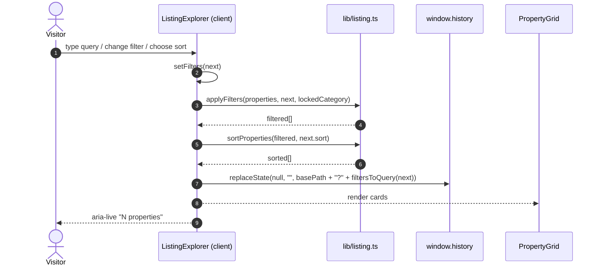

# Design: DABAW ESTATE Frontend-Only Real Estate Prototype

## Technical Approach

Build a server-first Next.js 16.4.2 App Router site under the repo-root `app/`. Static content is rendered by Server Components; interactivity is isolated in small `"use client"` islands. All property data is a typed, synchronous TypeScript module, so the build prerenders every route without a database, API, server action, or environment key.

The design follows the Next.js 16.4.2 bundled docs, not older assumptions:

- `cacheComponents: true` makes PPR the default. URL data (`params`, `searchParams`) must not be read outside a `<Suspense>` boundary if the shared App Shell is to stay static.
- `params` and `searchParams` are promises. Dynamic detail pages await `params` inside a Suspense-wrapped child; detail pages are enumerated with `generateStaticParams`.
- `useSearchParams()` is a client hook and requires a Suspense boundary on a prerendered page.
- `window.history.replaceState` integrates with the App Router and keeps `useSearchParams` in sync without an RSC navigation.
- Next.js 16 deprecates `Image.priority`; the hero uses `preload`.
- `next/font/google` downloads and self-hosts fonts at build time.

No `use cache` directive is added: there is no async I/O and no expensive computation to cache. Local module imports are static.

## Architecture Overview

### Route rendering strategy

| Route | Segment | Rendering | Client islands | Reason |
|---|---|---|---|---|
| `/` | `app/page.tsx` | Static Server Component | `HeroSearch`, `FavoriteButton`, `SafeImage` | Content is deterministic; only search submission and favorite state are interactive. |
| `/properties` | `app/properties/page.tsx` | Static shell + Suspense island | `ListingExplorer` subtree | Filtering must run in the browser; `useSearchParams` is isolated under Suspense. |
| `/properties/[slug]` | `app/properties/[slug]/page.tsx` | Prerendered per slug + Suspense | `PropertyGallery`, `FavoriteButton`, `PropertyInquiryForm`, `SafeImage` | `params` is URL data; known slugs come from `generateStaticParams`, unknown slugs call `notFound()`. |
| `/buy`, `/rent`, `/commercial`, `/short-stays` | one `page.tsx` each | Static Server Component + Suspense island | `ListingExplorer` scoped by `lockedCategory` | Same browser filtering as `/properties`, with the category fixed by the route. |
| `/contact` | `app/contact/page.tsx` | Static Server Component | `InquiryForm` | Contact copy is static; the form is simulated locally. |
| `/admin` | `app/admin/page.tsx` | Static metadata shell | `AdminDashboard` | All CRUD state is in-memory client state. |
| unmatched routes | `app/not-found.tsx` | Static Server Component | none | Shell-level 404 with a link back to listings. |
| unknown property slug | `app/properties/[slug]/not-found.tsx` | Static Server Component | none | Property-specific 404 rendered by `notFound()`. |

`cacheComponents` / `partialPrefetching` remain enabled. Default `<Link>` prefetching is retained; no `prefetch={true}` is added because it would trigger per-link server work for URL-dependent detail content. `generateMetadata` reads `params` for detail pages; this is build-known for the twelve generated slugs and does not require dynamic rendering.

### Component tree

```text
RootLayout (Server)
├── SkipLink
├── SiteHeader (Client: pathname, mobile menu)
│   ├── wordmark + DAVAO CITY · PHILIPPINES
│   ├── PrimaryNav (Buy, Rent, Commercial, Short Stays, Contact)
│   ├── "Explore Properties" action -> /properties
│   └── MobileMenu (aria-expanded/controls, Escape, focus return)
├── <main id="main-content"> {children} </main>
└── SiteFooter (Server: nav + demo disclosure)

HomePage (Server)
├── Hero + HeroSearch (Client)
├── Featured -> PropertyGrid -> PropertyCard -> FavoriteButton (Client)
├── CategoryGrid -> CategoryCard
├── AreaHighlights
├── WhySection
└── CTA + DemoNotice

PropertiesPage / CategoryPage (Server)
└── Suspense -> ListingExplorer (Client)
    ├── PropertySearch
    ├── PropertyFilters
    ├── ActiveFilters + sort select (owned by the explorer)
    ├── aria-live result count
    └── PropertyGrid -> PropertyCard -> FavoriteButton

PropertyDetail (Server, awaits params inside Suspense)
├── Back link + DemoNotice
├── PropertyGallery (Client)
├── Header/badges/price + FavoriteButton (Client)
├── Facts + Description + Amenities
├── PropertyInquiryForm (Client)
└── RelatedProperties -> PropertyGrid

AdminPage (Server metadata) -> AdminDashboard (Client)
├── persistent demo banner
├── overview cards
├── searchable property list
├── AdminPropertyForm (add/edit dialog)
├── AdminDeleteDialog (native dialog)
└── AdminInquiryPreview (sample data)
```

`PropertyCard`, `PropertyGrid`, and formatting helpers import no server-only APIs. They render as Server Components on static pages and join the client graph when imported by `ListingExplorer`, so filtered results can re-render without a second component implementation.

## Architecture Decisions

### Decision: Server-vs-Client split

**Choice**: Server Components by default; client islands only for URL-derived listing state, favorites, gallery, inquiry forms, admin state, mobile navigation, and image error fallback.
**Alternatives considered**: Fully client-rendered SPA; server-side filtering via the page `searchParams` prop; React Server Actions for filtering.
**Rationale**: Server-first keeps the static shell, metadata, and HTML for every route while limiting JavaScript to interaction. Server-side filtering would make every keystroke a request/dynamic render, violating the no-network filtering requirement. Server Actions are explicitly out of scope.

### Decision: URL-synced filters vs local-only state

**Choice**: Local React state is the rendering source of truth. It initializes from `useSearchParams()` and writes back with `window.history.replaceState` after each change. Query parameters are the persistence/share format.
**Alternatives considered**: `router.replace` on every change (triggers an RSC navigation request per keystroke); page `searchParams` server filtering (dynamic rendering plus a request); local state only (fails reload/share scenarios).
**Rationale**: `replaceState` changes the URL without a page reload or data request, and Next.js syncs it with `useSearchParams`. Reloading reconstructs state from the validated URL parser. The explorer is mounted once per page navigation, so no two-way effect loop is needed.

### Decision: Favorites persistence via localStorage vs session-only

**Choice**: Persist only property IDs under `dabaw-estate:favorites`. A module-level store exposes `subscribe`, `getSnapshot`, and `getServerSnapshot`; components read it with `useSyncExternalStore`. Reads are guarded, validated as `string[]`, deduplicated, and capped. Storage failures fall back to an in-memory set. A `storage` event syncs other tabs.
**Alternatives considered**: React Context plus `useEffect` hydration (extra provider and an effect-driven flash); session-only React state (fails the reload scenario); cookies or a database (forbidden/overkill).
**Rationale**: The external store keeps every rendered toggle in sync without a provider, gives a stable server snapshot for hydration, and tolerates corrupt or unavailable storage without crashing.

### Decision: Add `lucide-react` vs inline SVG icons

**Choice**: Add `lucide-react` as the only new runtime dependency and install it with npm, updating `package.json` and `package-lock.json`.
**Alternatives considered**: Hand-written inline SVGs; no icons; another icon package.
**Rationale**: `docs/theme.md` §14 mandates Lucide. It is tree-shaken ESM with consistent stroke weight and accessible defaults. Inline SVGs would duplicate markup and invite inconsistent sizing/stroke. The dependency is currently absent, so installation is an explicit implementation step.

### Decision: Mock data as TypeScript modules vs JSON

**Choice**: `data/*.ts` modules, with `properties` declared as `readonly Property[]` via `satisfies`. Query helpers (`getPropertyBySlug`, `getFeatured`, `getByCategory`, `getRelated`) live beside the records.
**Alternatives considered**: JSON plus `resolveJsonModule`; MDX; remote CMS/API.
**Rationale**: TypeScript validates the union fields (`category`, `transactionType`, `propertyType`, `location`, `status`) at compile time, supports `readonly` tuples for filters, and requires no runtime fetch. JSON would defer enum errors to runtime; a remote source violates the hard constraint.

### Decision: Remote images through `next/image` vs plain ``

**Choice**: Configure `images.remotePatterns` for `images.unsplash.com` and `images.pexels.com`, render via `next/image` inside a client `SafeImage` wrapper, use `fill` + `sizes`, and use `preload` for the single hero LCP image.
**Alternatives considered**: Plain `` (no optimization, layout-shift risk); `next/image` with `unoptimized` (no optimization); local assets (no remote imagery).
**Rationale**: `next/image` reserves layout space, generates responsive `srcset`, and hides the deprecated `priority` API. `SafeImage` supplies a fixed-aspect fallback surface on error. The remote allowlist is minimal and path-scoped.

### Decision: Admin state isolated from public data

**Choice**: `/admin` initializes `useState` from a shallow copy of the sample properties. Add/edit/delete mutate only that copy. Public pages always read the immutable module.
**Alternatives considered**: Lifting all properties into a shared client provider so admin edits appear publicly; persisting to `localStorage`; server mutations.
**Rationale**: The spec defines admin changes as temporary and browser-session-only. Isolating them keeps the public demo deterministic and avoids shipping the full dataset into a global provider. Reload resets admin state naturally; Activity-preserved state on back navigation is still session-only.

## State Strategy

| State | Owner | Lifetime | Persistence |
|---|---|---|---|
| Listing query, filters, sort | `ListingExplorer` | Page mount | URL query string via `replaceState` |
| Category lock | Server prop `lockedCategory` | Page mount | Route path |
| Favorites | `lib/favorites-store.ts` + `useSyncExternalStore` | App session | `localStorage` IDs only |
| Mobile menu open/focus | `SiteHeader` | Layout | None |
| Gallery index | `PropertyGallery` | Detail mount | None |
| Inquiry values/errors/pending | `InquiryForm` | Form mount | None (never stored) |
| Admin properties/editor/delete target | `AdminDashboard` | `/admin` mount | None (reset on reload) |

URL contract: `q`, `category`, `transaction`, `area`, `minPrice`, `maxPrice`, `beds`, `baths`, `sort`. Invalid values are dropped by the parser; defaults are omitted when serialized. On category routes, `category` is fixed by the path and ignored in the URL. The homepage `HeroSearch` exposes labeled area, category, and transaction controls and pushes `/properties?area=…&category=…&transaction=…`; an empty selection pushes `/properties` and therefore shows all records.

Data flow:

```text
data/properties.ts (immutable, synchronous)
   ├── Server pages ──props──> Server sections / cards
   └── props ──> ListingExplorer (client) ──filter/sort──> client grid
                                │
                                └── replaceState("?q=...&sort=...")

favorites-store <──toggle── FavoriteButton (every instance subscribes)
        └── localStorage (IDs only, guarded)

AdminDashboard (client copy) ──useState──> overview + list + dialogs
InquiryForm (client) ──setTimeout──> success message (no transmission)
```

## Data Model and Interfaces

```ts
// types/property.ts
export const CATEGORIES = ["for-sale", "for-rent", "commercial", "short-stay"] as const;
export type Category = (typeof CATEGORIES)[number];

export const TRANSACTIONS = ["sale", "rent", "lease"] as const;
export type TransactionType = (typeof TRANSACTIONS)[number];

export const DAVAO_AREAS = [
  "Matina", "Ecoland", "Buhangin", "Lanang",
  "Bajada", "Toril", "Downtown Davao",
] as const;
export type DavaoArea = (typeof DAVAO_AREAS)[number];

export const PROPERTY_TYPES = [
  "House", "Townhouse", "Condominium", "Apartment", "Lot",
  "Office", "Retail", "Warehouse", "Transient",
] as const;
export type PropertyType = (typeof PROPERTY_TYPES)[number];

export interface PropertyImage { src: string; alt: string }

export interface Property {
  id: string;
  slug: string;
  title: string;
  category: Category;
  transactionType: TransactionType;
  propertyType: PropertyType;
  price: number;                       // PHP, whole pesos
  priceLabel?: "/month" | "/night";
  location: DavaoArea;
  addressLabel?: string;               // fictional, optional
  description: string;
  images: PropertyImage[];             // [0] is the card/hero image
  bedrooms?: number;
  bathrooms?: number;
  floorArea?: number;                  // sqm
  lotArea?: number;                    // sqm
  parking?: number;                    // slots
  amenities?: string[];
  featured: boolean;
  status: "sample";
  createdAt: string;                   // ISO date
}
```

Dataset: 12 records, unique `id` and `slug`, all seven areas, all four categories. Sale 3 (`Matina Family Home`, `Ecoland Garden Townhouse`, `Lanang Skyline Condo`), rent 4 (`Bajada City Apartment`, `Matina Greenview House`, `Buhangin Parkview Apartment`, `Downtown Executive Loft`), commercial 2 (`Lanang Retail Frontage`, `Toril Logistics Warehouse`), short stay 3 (`Ecoland Short Stay Suite`, `Downtown Heritage Studio`, `Toril Riverside Transient`). Three are featured. Prices are fictional peso amounts; rent/short-stay records carry `priceLabel`.

Filter metadata is a set of `as const` option arrays in `types/property.ts` (`CATEGORY_LABELS`, `TRANSACTION_LABELS`, `SORT_OPTIONS`, `BED_OPTIONS`, `BATH_OPTIONS`). `data/categories.ts` adds route/label/blurb/image metadata for the four homepage cards; `data/areas.ts` adds the seven area highlights.

```ts
// lib/listing.ts
export interface ListingFilters {
  q: string;
  category?: Category;
  transaction?: TransactionType;
  area?: DavaoArea;
  minPrice?: number;
  maxPrice?: number;
  beds?: number;       // minimum, 4 means 4+
  baths?: number;      // minimum
  sort: "featured" | "newest" | "price-asc" | "price-desc";
}

parseListingFilters(input: URLSearchParams | Record<string, string | string[] | undefined>): ListingFilters;
applyFilters(properties: readonly Property[], filters: ListingFilters, lockedCategory?: Category): Property[];
sortProperties(properties: readonly Property[], sort: ListingFilters["sort"]): Property[];
filtersToQuery(filters: ListingFilters): string;
countActiveFilters(filters: ListingFilters): number;
```

Matching is case-insensitive against `title`, `location`, and `description`; all active filters combine with AND. Bed/bath filters only match records that expose a value at or above the minimum, so commercial records without bedrooms are correctly excluded when a bedroom filter is active. `minPrice > maxPrice` drops both bounds rather than producing a contradictory result. Sorting is stable; `featured` sorts featured records first, then newest.

```ts
// lib/favorites-store.ts
subscribe(listener: () => void): () => void;
getSnapshot(): ReadonlySet<string>;
getServerSnapshot(): ReadonlySet<string>;
toggleFavorite(id: string): void;
```

`lib/constants.ts` owns exact copy: the demo disclosure, admin banner, inquiry success string, and storage key. `lib/validation.ts` exports `validateInquiry(values)` and `validatePropertyDraft(draft)` returning field-keyed error maps; both are pure and shared by forms. Inquiry values are `{ name, email, phone, message, propertySlug? }`: `/contact` leaves the property select optional, while the detail-page wrapper preselects the current listing and shows its title. At least one of email/phone is required; a provided email is format-checked.

## Theme Token Mapping

`docs/theme.md` §3/§17 literals go directly into Tailwind v4's `@theme` block. This emits the documented CSS variables and generates `bg-forest`, `text-charcoal`, `border-border`, `rounded-card`, `rounded-control`, and `max-w-page`. Spacing needs no custom scale: Tailwind's default 4 px scale already matches `docs/theme.md` §5, so sections use standard `py-16 md:py-24`, `gap-6`, and container padding `px-4 sm:px-6 lg:px-12`. `@theme inline` is used only for the runtime font variables; it must not map a variable to itself.

```css
@import "tailwindcss";

@theme {
  --color-forest: #183D32;
  --color-forest-hover: #245344;
  --color-forest-deep: #102B23;
  --color-gold: #D8B77A;
  --color-gold-soft: #E9D9B6;
  --color-ivory: #F7F5EF;
  --color-white: #FFFFFF;
  --color-charcoal: #242824;
  --color-muted: #6C726D;
  --color-border: #E4E3DC;
  --color-surface-muted: #EFEEE8;
  --color-success: #2F6B4F;
  --color-error: #B54747;
  --color-warning: #8A641D;
  --radius-card: 16px;
  --radius-control: 10px;
  --container-page: 1280px;
}

@theme inline {
  --font-display: var(--font-dm-serif);
  --font-sans: var(--font-inter);
}
```

`app/layout.tsx` loads both fonts and applies their variables on `<html>`:

```tsx
const display = DM_Serif_Display({ subsets: ["latin"], weight: "400",
  variable: "--font-dm-serif", display: "swap" });
const sans = Inter({ subsets: ["latin"], variable: "--font-inter", display: "swap" });
// <html lang="en" className={`${display.variable} ${sans.variable}`}>
```

Base styles set `body` to ivory/charcoal/Inter. Component classes enforce the scale from `docs/TYPOGRAPHY.MD`: `.type-hero` (clamp 2.25rem–4.5rem, line-height 1.08), `.type-page-title` (1.875rem–3rem), `.type-section-title` (1.5rem–2.25rem), and `.price` with `font-variant-numeric: tabular-nums` and tight tracking. Display headings use `font-display`; prices and all UI text use `font-sans`. A global `:focus-visible` rule provides a 2 px forest ring with offset. A `prefers-reduced-motion: reduce` media query collapses animation/transition durations and disables smooth scrolling.

## next.config.ts Changes

Add only an image allowlist; keep `cacheComponents`, `partialPrefetching`, `experimental.agentFeedback`, and the Turbopack CSS rule untouched.

```ts
images: {
  remotePatterns: [
    { protocol: "https", hostname: "images.unsplash.com", pathname: "/**" },
    { protocol: "https", hostname: "images.pexels.com", pathname: "/**" },
  ],
},
```

No `deviceSizes`, `imageSizes`, or `qualities` override is needed: cards use `fill` with `sizes="(max-width: 640px) 100vw, (max-width: 1024px) 50vw, 33vw"`, the gallery uses a single `sizes` based on its column width, and the hero uses `sizes="100vw"` plus `preload`. `priority` is not used.

## Accessibility Approach

- One `<main id="main-content">` in the root layout; header/footer are landmarks; a skip link precedes the header. Footer contains a labeled navigation and the demo disclosure.
- One `<h1>` per page. Section headings are `<h2>`; card and fact titles are `<h3>`. No heading levels are skipped for visual styling.
- Every control has a persistently visible label. Icon-only buttons get an `aria-label` that includes the property title where applicable. Errors use `aria-invalid` and `aria-describedby`; dialog labels use `aria-labelledby`.
- Result counts use `role="status" aria-live="polite" aria-atomic="true"`. Inquiry success and admin save feedback use polite status regions. Gallery position is announced as “Image 2 of 3”.
- Focus: global `:focus-visible` ring, `scroll-mt-*` on anchored sections, dialog focus moved in and returned to the trigger, mobile menu focus moved to the first link and returned to the trigger on Escape/close.
- Targets: icon buttons and compact controls use `min-h-11 min-w-11` (44 px); nav links use padded hit areas.
- Mobile listings collapse filters into a labeled disclosure button (`aria-expanded`, `aria-controls`) whose panel stacks vertically; the admin property list stacks rows into cards below `md` so the page never scrolls horizontally.
- State is never color-only: favorites expose `aria-pressed` plus icon/label change; badges include text; errors include an icon and text.
- Motion respects `prefers-reduced-motion`; no parallax or auto-playing carousel.
- Images: meaningful `alt` text; decorative surfaces use `alt=""`; `SafeImage` preserves aspect ratio and shows an “Image unavailable” fallback.

## Sequence Diagrams

### Listing search, filter, and sort



### Inquiry submit simulation

```mermaid
sequenceDiagram
  autonumber
  actor U as Visitor
  participant F as InquiryForm (client)
  participant V as lib/validation.ts
  U->>F: submit
  F->>V: validateInquiry(values)
  alt validation errors
    V-->>F: field-keyed errors
    F-->>U: inline errors + focus first invalid field
  else valid
    F->>F: setStatus("pending"); disable submit
    F->>F: setTimeout(600 ms)
    F-->>U: "Demo submission complete. No message was sent."
  end
  Note over F: No fetch, API, email, or persistent storage
```

### Admin add/edit/delete

```mermaid
sequenceDiagram
  autonumber
  actor A as Owner
  participant D as AdminDashboard (client)
  participant F as AdminPropertyForm
  participant X as AdminDeleteDialog
  A->>D: open add or edit
  D->>F: initial values (empty or selected property)
  A->>F: submit
  F->>F: validatePropertyDraft + unique slug
  F-->>D: onSave(property)
  D->>D: setItems(next) (in-memory copy)
  D-->>A: updated list, overview counts, status message
  A->>X: activate delete
  X-->>A: showModal(); focus moves into dialog
  A->>X: confirm
  X-->>D: onConfirm(id)
  D->>D: setItems(items.filter(...))
  X-->>A: close(); focus returns to delete trigger
```

### Favorites toggle and persistence

```mermaid
sequenceDiagram
  autonumber
  participant B as FavoriteButton (any instance)
  participant S as favorites-store
  participant LS as localStorage
  participant O as Other FavoriteButtons
  B->>S: toggleFavorite(id)
  S->>S: mutate cached Set; notify subscribers
  S->>LS: setItem(key, JSON.stringify(ids)) in try/catch
  S-->>O: new snapshot
  O-->>B: aria-pressed and icon update everywhere
  Note over S: Invalid JSON or unavailable storage -> safe memory-only state
  Note over S: "storage" event syncs other tabs
```

## File Map

### Modified

| File | Action | Description |
|---|---|---|
| `app/layout.tsx` | Modify | DM Serif Display + Inter variables, metadata template, skip link, header/main/footer shell. |
| `app/globals.css` | Modify | `@theme` tokens, base typography, focus/reduced-motion rules, type utilities. |
| `app/page.tsx` | Modify | Replace starter page with the homepage composition. |
| `next.config.ts` | Modify | Add `images.remotePatterns` for Unsplash and Pexels. |
| `package.json` | Modify | Add `lucide-react` runtime dependency. |
| `package-lock.json` | Modify | Lockfile generated by `npm install lucide-react`. |

### New route segments

| File | Description |
|---|---|
| `app/not-found.tsx` | Shell-level not-found with a link to `/properties`. |
| `app/properties/page.tsx` | All-listings page; static shell + Suspense `ListingExplorer`. |
| `app/properties/[slug]/page.tsx` | Detail page; `generateStaticParams`, `generateMetadata`, Suspense child awaiting `params`. |
| `app/properties/[slug]/not-found.tsx` | Property-specific not-found message and back link. |
| `app/buy/page.tsx` | For Sale category page. |
| `app/rent/page.tsx` | For Rent category page. |
| `app/commercial/page.tsx` | Commercial category page. |
| `app/short-stays/page.tsx` | Short Stay category page. |
| `app/contact/page.tsx` | Contact information plus simulated inquiry form. |
| `app/admin/page.tsx` | Admin metadata shell rendering `AdminDashboard`. |

### Layout and UI components

| File | Description |
|---|---|
| `components/layout/site-header.tsx` | Client header: pathname active state, primary action, mobile menu focus/Escape handling. |
| `components/layout/site-footer.tsx` | Server footer: navigation, brand line, demo disclosure. |
| `components/layout/demo-notice.tsx` | Server disclosure component with compact/default variants. |
| `components/ui/container.tsx` | Page-width and responsive padding wrapper. |
| `components/ui/button.tsx` | Shared button/link variants and focus/target styles. |
| `components/ui/badge.tsx` | Category, transaction, featured, and sample badges. |
| `components/ui/section-heading.tsx` | Eyebrow + heading + optional supporting copy. |
| `components/ui/empty-state.tsx` | Empty listings/admin state with action slot. |
| `components/ui/skeleton.tsx` | Suspense fallbacks for listings and details. |
| `components/ui/safe-image.tsx` | Client `next/image` wrapper with error fallback and fixed aspect ratio. |
| `components/ui/inquiry-form.tsx` | Shared client inquiry form: fields, validation, pending, exact success message. |

### Property components

| File | Description |
|---|---|
| `components/properties/property-card.tsx` | Card with image, badges, favorite, title, area, price, applicable facts, detail link. |
| `components/properties/property-grid.tsx` | Responsive 1/2/3-column grid. |
| `components/properties/favorite-button.tsx` | Client store-backed toggle with `aria-pressed` and title-bearing label. |
| `components/properties/property-search.tsx` | Labeled listing text search input. |
| `components/properties/property-filters.tsx` | Category, transaction, area, price min/max, beds, baths controls. |
| `components/properties/listing-explorer.tsx` | Client orchestrator: state, URL sync, active filters, sort, count, empty state. |
| `components/properties/property-gallery.tsx` | Client gallery: previous/next, counter live region, error fallback, reduced motion. |
| `components/properties/related-properties.tsx` | Up to three related records, excluding the current slug. |
| `components/properties/category-card.tsx` | Homepage category card linking to its route. |
| `components/properties/area-highlights.tsx` | Seven Davao area highlights. |
| `components/properties/hero-search.tsx` | Client homepage search; pushes validated criteria to `/properties`. |
| `components/properties/property-inquiry-form.tsx` | Detail-page inquiry wrapper with property preselected and identified. |

### Admin components

| File | Description |
|---|---|
| `components/admin/admin-dashboard.tsx` | Client state owner: copy of data, search, add/edit/delete, overview counts, status regions. |
| `components/admin/admin-property-form.tsx` | Accessible add/edit dialog form with validation and generated ID/slug. |
| `components/admin/admin-delete-dialog.tsx` | Native `<dialog>` confirmation with focus entry/return. |
| `components/admin/admin-inquiry-preview.tsx` | Clearly labeled sample inquiry list. |

### Data, types, and utilities

| File | Description |
|---|---|
| `data/properties.ts` | Twelve typed records plus lookup/featured/category/related helpers. |
| `data/categories.ts` | Four category cards with labels, routes, blurbs, and images. |
| `data/areas.ts` | Seven Davao area highlights. |
| `data/demo-inquiries.ts` | Clearly marked sample inquiries for admin preview. |
| `types/property.ts` | Property, image, category, transaction, area, property-type unions and option metadata. |
| `types/inquiry.ts` | Inquiry values, errors, and demo inquiry shape. |
| `lib/constants.ts` | Exact disclosure, banner, success, and storage-key strings. |
| `lib/navigation.ts` | Shared primary/footer navigation items. |
| `lib/listing.ts` | Filter parsing, application, sorting, query serialization, active-filter count. |
| `lib/favorites-store.ts` | Safe localStorage store and `useSyncExternalStore` snapshots. |
| `lib/validation.ts` | Pure inquiry and admin property-draft validation. |
| `lib/utils.ts` | `cn`, PHP price formatting, area/number formatting, slug generation. |

## Testing and Verification Strategy

No test runner is installed. Verification uses the configured commands plus a manual scenario matrix derived from the specs.

| Layer | What to verify | Approach |
|---|---|---|
| Static | Types, union constraints, imports, accessibility props | `npx tsc --noEmit` (after typegen if `.next/types` is absent) |
| Lint | Next.js core-web-vitals and TypeScript rules | `npm run lint` |
| Build | All nine routes prerender; Suspense boundaries satisfy `useSearchParams`; remote image config accepted | `npm run build` |
| Manual UI | Spec scenarios for search, filters, sort, empty states, details, inquiry, favorites, admin | `npm run dev` route checklist at 320/360/375/768/1280 px |
| Manual a11y | Keyboard order, focus return, Escape, labels, live regions, contrast, reduced motion | Tab/Shift+Tab, DevTools rendering emulation, screen-reader spot check |

Key manual checks: homepage has exactly one H1 with “Find your place in Davao.” and featured cards only; `/properties` shows 12 initially, `q=Lanang` matches area/description, combined filters produce AND results, reload preserves controls, zero results shows the empty state, clear restores 12; `/buy` 3, `/rent` 4, `/commercial` 2, `/short-stays` 3; an unknown slug shows the property not-found; gallery next/previous works by keyboard and announces position; inquiry empty submit focuses the first invalid field, invalid email is rejected, success text is exact and no request appears in DevTools; admin counts start at 12, add increments, edit updates the row, delete requires confirmation, reload resets; favorites sync card/detail, survive reload, ignore corrupt JSON, and work with storage blocked. The config `npm run lint && npx tsc --noEmit && npm run build` is the release gate; if typegen has not run, run `npm run build` once before `tsc`.

## Threat Matrix

N/A — this change adds Next.js page routes, not shell command routing, subprocess execution, VCS/PR automation, executable-file classification, or process integration. No applicable row from `references/threat-matrix.md`; no threat-matrix tasks or RED tests are created.

## Risks and Mitigations

| Risk | Likelihood | Mitigation |
|---|---|---|
| Google Fonts download fails during an offline build | Medium | Run `npm run build` early. If fetching fails, switch to `next/font/local` with the same `--font-*` variables or system fallback stacks; do not change component classes. |
| Missing Suspense around `useSearchParams` fails production build | Medium | Keep every URL-data island under `<Suspense>` in `/properties`, category pages, and detail pages; verify with `npm run build`. |
| Remote image host or URL failure | Medium | Minimal `remotePatterns`, fixed dimensions, `SafeImage` fallback, curated URLs, alt text. |
| Hydration mismatch or corrupt favorites JSON | Medium | `useSyncExternalStore` with a stable server snapshot; lazy guarded parsing; memory fallback; test corrupt value and blocked storage. |
| `cacheComponents` blocking-route insight from `params`/`searchParams` | Low | Await `params` in a Suspense child; never read server `searchParams`; keep listing filtering client-side. |
| `lucide-react` install unavailable | Low | If npm install fails, temporarily inline the required SVGs in `components/ui` without changing component APIs; retry installation before release. |
| Native `<dialog>` focus/Escape differences | Low | Use `showModal`, `onClose`, and trigger refs; verify keyboard and focus return in Chromium/Firefox/Safari. |
| Tailwind v4 token wiring error | Low | Use direct `@theme` literals and `@theme inline` only for font variables; inspect generated utilities in build CSS. |
| URL drift after browser back/forward | Low | `replaceState` creates no history entries; verify reload and cross-page navigation. If drift appears, add a single `useSearchParams` synchronization effect keyed by the query string. |
| Admin edits not reflected publicly | Low | Intentional per spec; banner states changes are temporary. No shared provider or persistence. |

## Migration / Rollout

No data migration and no database. Rollout is additive: install `lucide-react`, establish tokens/layout, add data/types/utilities, then routes and components in spec order. No feature flags are needed. Favorites may leave a harmless `dabaw-estate:favorites` key in a visitor's browser.

## Rollback

Per-commit `git revert` is the primary rollback. For a hard reset of the implementation:

```powershell
git checkout -- app/layout.tsx app/page.tsx app/globals.css next.config.ts package.json package-lock.json
Remove-Item -Recurse -Force app/properties, app/buy, app/rent, app/commercial, app/short-stays, app/contact, app/admin
Remove-Item -Force app/not-found.tsx
Remove-Item -Recurse -Force components, data, lib, types
npm uninstall lucide-react
```

No persisted server data, schema, or credentials exist. Favorites can be cleared by removing the `dabaw-estate:favorites` key; admin and inquiry data disappear with the page session.

## Open Questions

- [ ] None blocking. The design resolves commercial transaction labelling as `lease` for leased commercial records and `sale` for for-sale commercial records; admin edits remain isolated from public pages as documented above.
